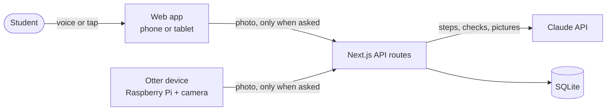

# Ayin

**Ayin helps autistic students finish hands-on job tasks on their own.** It shows the next step as a simple picture, checks the step with the camera, gives more help only when asked, and connects the student with a small crew of peers. Help fades as the student succeeds.

Built for the 2026 North American AI Challenge for Neurodiverse Learning, with research at our partner school, [Arizona Autism Charter Schools](https://www.autismcharter.org/) (AZACS), and ideas from [First Place AZ](https://firstplaceaz.org/).

We're building this for the Nov 5 submission, so some parts are still in progress. See [Status and limitations](#status-and-limitations).

---

## The problem

At AZACS, students aged 16–22 learn real job tasks at school-run work sites: a café, a shirt studio and a shipping store. Each task has many steps, and staff prompt students through them. The school's own goal is students *"demonstrating the need for fewer prompts."* At a first job, nobody prompts.

What we found (full notes and sources in [`docs/research.md`](docs/research.md)):

- Teachers keep problems to "just one step" and teach sequencing as a skill of its own.
- Students learn best by seeing and doing: *"we learn from our mistakes visually."*
- Help that never fades creates dependence. The school measures success as needing fewer prompts.
- About 40% of autistic young adults never got together with friends in a year.
- Anything worn on the body is a sensory problem, so Ayin needs nothing worn.

## What Ayin does

**1. See it, step by step.** The student says or shows a task ("make an iced latte"). Ayin breaks it into steps and shows one at a time: a picture made for that step, 8 words or fewer, read aloud.

- **Done**: the camera checks the step and Ayin moves on, or says what's missing.
- **Help**: more help, one level at a time (nudge, then hint, then "show me" with a picture). Help only comes when asked.
- **Fading**: after 3 runs of a step with no help, Ayin starts one level lower next time and tells the student. They can always turn it back up.

**2. Crew.** A small group of students from the same work site, set up by staff.

- A shared weekly goal ("our café crew: 20 tasks on our own"), not a ranking.
- Weekly rings that quietly restart each week. There is no daily streak that can break.
- One-tap cheers with preset words.
- **Ask a crewmate**: when Ayin's hints aren't enough, it suggests a crewmate who has done that step on their own.

Every step is logged as "on my own" or "with help". The student sees their log first, and that log drives both the rings and the fading.

## How it works



- **One server, many "doors."** The web app and the otter device call the same API. The phone camera works today; the otter runs the same flow.
- **Claude** turns a task into steps, checks a step from a photo, writes hints, and draws a simple SVG picture for each step. Pictures are drawn once per task and reused.
- **SQLite** stores tasks, steps, the log and crews. No photos are stored.

## Repository layout

```
ayin-app/
├── web/        Next.js app: student screens and the API
├── device/     Raspberry Pi client for the otter (camera, speaker)
├── hardware/   3D-printable otter enclosure and build guide
└── docs/       Our plan, research notes and AI prompts
```

Each folder has its own README.

## Run it locally

You need Node.js 20+ and an [Anthropic API key](https://console.anthropic.com/).

```bash
cd web
cp .env.example .env.local     # then paste your API key into .env.local
npm install
npm run seed                   # creates a demo crew so the crew screen has data
npm run dev                    # open http://localhost:3000
```

Use Chrome or Safari: the app uses the browser's built-in speech for reading steps aloud and hearing "done" and "help".

To run the otter device, see [`device/README.md`](device/README.md).

## How we use AI

In the product, Claude (through the official Anthropic SDK) breaks a task into steps, checks a step from a photo, writes hints and draws step pictures. Those prompts live in [`web/src/lib/ai/`](web/src/lib/ai/).

To build it, we wrote the plan first ([`docs/plan.md`](docs/plan.md)) and then worked through it with Claude Code as a pair programmer, reviewing every change. The prompts that shaped the project are in [`docs/ai-prompts.md`](docs/ai-prompts.md).

## Privacy and safety

- **Camera only when asked.** A photo is taken when the student taps Done or Help. Photos are sent to Claude and never stored.
- **The student owns their log.** They see it first.
- **Crews are closed.** Staff add members from the same program. No strangers, no location, no free-text messages between students: cheers and asks use preset words.
- **No guilt.** No red, no "overdue", no broken streaks, no leaderboard.
- **No secrets in the repo.** Keys live in `.env.local`, which git ignores.

## Status and limitations

- Built during the challenge sprint. Ayin's earlier prototype (a voice assistant and camera glasses) is **not** in this repo; this repo was started fresh on Nov 4.
- There are no student accounts yet: the demo uses a profile picker.
- The otter device code is written but not yet tested on a real Raspberry Pi. The demo video uses a phone camera.
- Peer-support evidence covers ages 3–18 and mostly non-autistic peers; peer mentoring for ages 19–22 is barely studied.

## Team

| Name | Role |
| --- | --- |
| Sankritya Thakur | Product, research, app and server |
| Havi ([@Havishea](https://github.com/Havishea)) | Otter character and animations |

<!-- TODO: add the rest of the team and their roles before submitting. -->

## License

[MIT](LICENSE)
