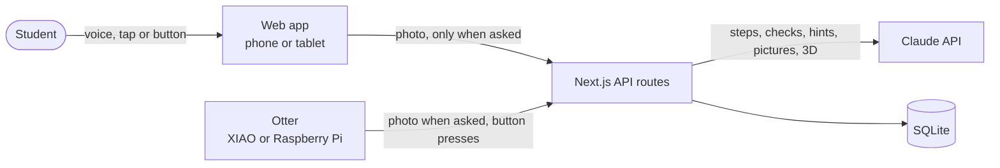

# Ayin

**Ayin helps autistic students finish hands-on job tasks on their own.** It shows one step at a time as a picture, checks the step with the camera, gives more help only when asked, and connects the student with a small crew of peers. Help fades as the student succeeds.

Built for the 2026 North American AI Challenge for Neurodiverse Learning, with research at our partner school, [Arizona Autism Charter Schools](https://www.autismcharter.org/) (AZACS), and ideas from [First Place AZ](https://firstplaceaz.org/).

## The problem

At AZACS, students aged 16–22 learn real job tasks at school-run work sites: a café, a shirt studio and a shipping store. Each task has many steps, and staff prompt students through them. The school's own goal is students *"demonstrating the need for fewer prompts."* At a first job, nobody prompts.

What we found (full notes and sources in [`docs/research.md`](docs/research.md)):

- Teachers keep problems to "just one step" and teach sequencing as a skill of its own.
- Students learn best by seeing and doing: *"we learn from our mistakes visually."*
- Help that never fades creates dependence. The school measures success as needing fewer prompts.
- About 40% of autistic young adults never got together with friends in a year.
- Anything worn on the body is a sensory problem, so Ayin needs nothing worn.

## What Ayin does

**Five stages, like First Place AZ.** First Place teaches a skill in five stages: watch, first tries, with help, with a check-in, on your own. Ayin follows the same path for each student and each task, works out the stage from the student's own log, and shows it before every task. A new task starts by watching every step; a mastered one is done alone, with Ayin checking only at the end.

**One step at a time.** The student says, types or shows a task ("make an iced latte"). Claude breaks it into small physical steps. Ayin shows one step at a time: a picture drawn for that step, 8 words or fewer, read aloud, with progress dots.

- **Done:** Ayin takes one photo and checks the step, then moves on or says what's missing.
- **Help:** one level at a time, and only when asked: a nudge, then a hint, then "show me".
- **Show me in 3D:** the thing the student is stuck on becomes a simple 3D model they can turn, with sticky-note labels and the part to act on glowing.
- **Smaller steps:** if a step feels too big, Ayin splits it into 2–4 smaller ones.
- **Time you can see:** a step that takes a set time (wash hands for 20 seconds) gets a calm ring timer. It never turns red.
- **Fading:** after 3 runs of a step with no help, the picture rests and the words lead. Any help brings it back.
- **Hands-free:** voice is on during a task, so "done" works with wet hands. "Watch for me" lets Ayin check every few seconds until each step is done, and "I did it" moves on when the camera can't see the step.
- **Talk to Ayin:** students can just ask out loud ("is this the right way up?"). Ayin looks through the camera and answers in a sentence or two, like a coach beside them.
- **No camera? Share a screen.** For tasks on a computer, or devices without a camera, Ayin can look at a shared screen or tab instead.

**Raft.** A group of otters floating together is called a raft. Each student's raft is a small, safe social space with others from the same work site, set up by staff.

- **Wins:** share what you made, with a photo of the work (never faces). Raftmates react with hand-drawn otter stickers that show who reacted, never a count.
- **Help board:** ask about any step. Raftmates who've done that step on their own see "You know this one" and can answer; the asker marks "This helped". Stuck mid-task? "Ask my raft" posts the question with the step attached.
- **Ayin checks every post and reply** before anyone sees it: kind, no personal info, no faces. If something might hurt, it suggests a kinder way to say it. One tap reports a post to staff.
- **Profiles:** each student's own goal, "how I work best", and "I can help with", which fills itself from tasks they've mastered.
- **Work card:** a one-page card a student can choose to share with a job coach or supervisor, with tips for giving them instructions. This is the employer side First Place AZ asked for.
- **One shared pond:** every raftmate's otter floats in it, and each step anyone does on their own raises the water. A group total, never a ranking, and no streaks to break.
- **Buddies:** Ayin pairs raftmates so each can show the other a step they've mastered, and they can ask each other to practise together. "Not today" is always one tap.

**Your own otter.** Every student picks the colour of their otter, Havi's character. It floats in the pond on the home screen, where their tasks drift as leaves and finished tasks collect in a basket.

**The otter on the counter.** A 3D-printed otter holds the camera in its pebble, with a privacy shutter. The Raspberry Pi version adds Done, Help and Show me buttons for students who don't speak. "Connect your otter" in the Me tab finds it on the Wi-Fi, shows a live photo through it and tests its buttons, with no files to edit.

**Paper too.** Any task prints as a step card with its pictures, to keep at the station.

## How it works



- **One server, many doors.** The phone and the otter call the same API and get the same answers. The camera is just a different way in.
- **Claude** breaks tasks into steps, checks a step from a photo, writes hints, draws an SVG picture per step and builds 3D models from simple shapes. Pictures and models are made once per step and reused.
- **One log drives everything.** Every finished step is logged as "on my own" or with the help it took. That log fades the help, fills the rings and matches the buddies.
- **SQLite** stores tasks, steps, the log and crews. No photos are ever stored.

## Repository layout

```
ayin-app/
├── web/                 Next.js app: screens and API
│   ├── src/app/         pages (Today, a task, Crew, Me) and API routes
│   ├── src/components/  screens, the 3D viewer, Havi's pond and otter
│   ├── src/lib/         data, Claude prompts (lib/ai), fading, buddies, weekly rings
│   ├── scripts/seed.ts  demo crew
│   └── tests/           unit tests
├── device/              the otter: XIAO camera sketch, Raspberry Pi camera and buttons
├── hardware/            3D-printable otter enclosure, built from code
└── docs/                our plan, research notes and AI prompts
```

## Run it locally

You need Node.js 22.13 or newer and an [Anthropic API key](https://console.anthropic.com/).

```bash
cd web
cp .env.example .env.local     # then paste your API key into .env.local
npm install
npm run seed                   # a demo crew so the crew screen has data
npm run dev                    # open http://localhost:3000
```

Use Chrome or Safari: Ayin uses the browser's built-in speech to read steps aloud and to hear "done", "help" and "show me". The first time a step is shown, its picture takes 15–30 seconds to draw; after that it is instant.

Checks:

```bash
npm test          # unit tests: help ladder, fading, weekly rings, buddies, picture safety
npm run lint
npx tsc --noEmit
```

The otter device is optional. See [`device/README.md`](device/README.md).

## How we use AI

In the product, Claude (through the official Anthropic SDK) breaks tasks into steps, checks steps from photos, writes hints, draws step pictures and builds 3D models. Each prompt is a small file in [`web/src/lib/ai/`](web/src/lib/ai/), and every answer is checked against a schema.

To build it, we wrote the plan first ([`docs/plan.md`](docs/plan.md)) and then worked through it with Claude Code as a pair programmer, reviewing every change. The prompts that shaped the project are in [`docs/ai-prompts.md`](docs/ai-prompts.md).

## Privacy and safety

- **Camera only when asked.** One photo when the student taps Done, Help or Show me. Photos go to Claude for that one answer and are never stored.
- **Pictures can't run code.** Step drawings are checked against a strict list of allowed SVG features and shown as images.
- **Crews are closed.** Staff add members from the same program. No strangers, no location, and cheers and asks use preset words, not free chat.
- **No guilt.** No red, no "overdue", no streaks to break, no leaderboard.
- **No secrets in the repo.** Keys live in `.env.local` and device secrets in `secrets.h`, both ignored by git.

## Status and limitations

- This repo was started fresh on Nov 4, during the challenge sprint. Our earlier prototype (a voice assistant and camera glasses) is not in it.
- There are no student or staff accounts yet: the demo uses a profile picker, and the crew comes from the seed script.
- The XIAO camera works. The Raspberry Pi otter code is written but hasn't been run on a Pi yet, and the current enclosure fits a Pi Zero, not the Pi 4.
- Peer-support evidence covers ages 3–18 and mostly non-autistic peers; peer mentoring for ages 19–22 is barely studied.

## Team

| Name | Role |
| --- | --- |
| Sankritya Thakur | Product, research, app and server |
| Havi ([@Havishea](https://github.com/Havishea)) | The otter character, its animation and the pond design |

<!-- TODO: add the rest of the team and their roles before submitting. -->

Havi's otter and pond components are credited at the top of each file in `web/src/components/otter` and `web/src/components/pond`.

## License

[MIT](LICENSE)
