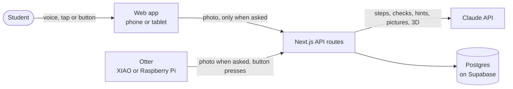

# Otto

**Otto helps autistic students finish hands-on job tasks on their own.** It turns any task into one small step at a time, shows each step as a 3D model you can turn and talks it through out loud, checks the real work through the camera, and connects students with a small "raft" of peers who've done it. Help fades as the student succeeds.

Built for the 2026 North American AI Challenge for Neurodiverse Learning, with research at our partner school, [Arizona Autism Charter Schools](https://www.autismcharter.org/) (AZACS), and ideas from [First Place AZ](https://firstplaceaz.org/).

**Try it:** the app at [ottocoach.vercel.app/app](https://ottocoach.vercel.app/app) (raft code `OTTER` joins the demo raft) · landing page for students and parents: [ottocoach.vercel.app](https://ottocoach.vercel.app) · pitch brief for the deck: [`docs/pitch.md`](docs/pitch.md)

## Our approach

- **Works on the device a school already has.** Phone, iPad, Chromebook or laptop: point its camera at the desk and Otto sees the work. AZACS already gives students Chromebooks and iPads, and AZACS staff told us anything worn is a sensory problem for their students, so there's nothing to buy and nothing to wear. (Adults who want camera glasses can choose them; see below.)
- **Complex things made simple.** Every task becomes one step at a time, and every step a diagram and a 3D model made for that task, talked through with a natural voice. The student can ask out loud at any point.
- **Real peers, not a chatbot.** The Raft routes help back to classmates who've mastered the step, lets students work side by side, and celebrates wins, with no video, no strangers and no rankings.
- **Built to be needed less.** Help steps down through First Place AZ's five stages, from watching every step to doing it alone.
- **A layer for hardware.** Any camera or button can plug in through two small endpoints (see [`device/`](device/README.md)): our 3D-printed otter, a document camera, a big accessibility switch. The app gives the same help whichever one the student uses.
- **Next: the Otto lamp.** A desk lamp with a camera looking down at the work that talks the student through it and points at the real part with light. The 3D-printed desk otter in this repo is a first step toward it.

## The problem

At AZACS, high school students and young adults up to 22 learn real job tasks at school-run work sites in the P.I.E.C.E. transition program (grades 9–12, plus a Transition Academy for ages 18–22): a café, a shirt studio and a shipping store. Each task has many steps, and staff prompt students through them. The school's own goal is students *"demonstrating the need for fewer prompts."* At a first job, nobody prompts.

What we found (full notes and sources in [`docs/research.md`](docs/research.md)):

- Teachers keep problems to "just one step" and teach sequencing as a skill of its own.
- Students learn best by seeing and doing: *"we learn from our mistakes visually."*
- Help that never fades creates dependence. The school measures success as needing fewer prompts.
- About 40% of autistic young adults never got together with friends in a year.
- For school-age students, anything worn on the body is a sensory problem, so Otto needs nothing worn. Adults are different: an early adult user asked for camera glasses, so glasses are an option for adults who choose them.

## What Otto does

**Five stages, like First Place AZ.** First Place teaches a skill in five stages: watch, first tries, with help, with a check-in, on your own. Otto follows the same path for each student and each task, works out the stage from the student's own log, and shows it before every task. A new task starts by watching every step; a mastered one is done alone, with Otto checking only at the end.

**One step at a time.** The student says, types or shows a task ("make an iced latte"). Claude breaks it into small physical steps. Otto shows one step at a time: a 3D model of that step the student can turn (a drawn picture while it builds), 8 words or fewer, read aloud, with progress dots.

- **Watch first:** at the first stage, Otto walks through every step in 3D on one screen and talks it through. The student can say "next", "back", or ask about what they're looking at.
- **Done:** Otto takes one photo and checks the step, then moves on or says what's missing.
- **Help:** one level at a time, and only when asked: a nudge, then a hint, then "show me".
- **Show me in 3D:** the thing the student is stuck on becomes a simple 3D model they can turn, with sticky-note labels and the part to act on glowing. The step's flat diagram shows straight away, and the 3D model takes its place as soon as Claude has built it (once per step, then saved), so nobody waits on a loading screen.
- **A real voice, both ways:** Otto speaks with Cartesia Sonic, with Deepgram Aura as a backup (the browser's own voice only if neither is set up), and words light up as they're said. It hears the student through Deepgram too: the microphone records only while someone is talking, and each clip goes through our server, so it works in every browser, iPhones included, and the key never reaches the device.
- **Smaller steps:** if a step feels too big, Otto splits it into 2–4 smaller ones.
- **Time you can see:** a step that takes a set time (steam milk for 30 seconds) gets a calm ring timer. It never turns red.
- **Fading:** after 3 runs of a step with no help, the picture rests and the words lead. Any help brings it back.
- **Hands-free:** one switch, on by default during a task, so "done" works with wet hands. Otto listens for "next", "done", "help" or any question, and ignores its own voice coming back through the microphone. It also notices when a step is done: the browser compares tiny frames on the device, and only when the student moves and then holds still does it send one photo to check. With the otter's camera it checks every few seconds. "I did it" moves on when the camera can't see the step.
- **Back on track:** if the camera sees the student drift to their phone during a step, Otto gives one gentle nudge back (never more than once a step). If they leave Otto for another app for a while, it says where they were when they come back, and Watch pauses instead of running on without them.
- **See what Otto sees:** the live camera is big on every task screen (beside the task on a laptop or tablet, across the top on a phone) and lights up when Otto looks, so nobody has to trust a camera they can't see.
- **Talk to Otto:** students can just ask out loud ("is this the right way up?"). Otto looks through the camera and answers in a sentence or two, like a coach beside them.
- **Chat with Otto:** on the home screen, saying hi gets a real answer. It happens right in the pond, not in a chat window: the leaves drift off, the pond draws in and Otto's words appear under the otter, each one lighting up as Otto says it, any line can be heard again, and there are always 2–3 ready answers to tap. Otto offers a task; the student taps Start. The otter reacts instead of looping: it leans toward the student's finger, leans in to listen, sways while thinking, hops on each word it says, and bounces when tapped. Tapping the otter starts a chat.
- **No camera? Share a screen.** For tasks on a computer, or devices without a camera, Otto can look at a shared screen or tab instead.

**Raft.** A group of otters floating together is called a raft. Each student's raft is a small, safe social space with others from the same work site, set up by staff.

- **One shared pond, live:** Havi's raft, where every raftmate's otter floats together and acts out what they really do. Someone who asked for help sits up and says so; a step done on your own splashes a tail; a cheer is said out loud with a head bump; a finished task pops a party; the task someone is on drifts beside them as a leaf. Tap an otter to help them, work with them, or see how they work best. Below it, the raft's weekly total fills a bar together. Only your own ring shows a number, so nobody is ranked, and there are no streaks to break.
- **Do it together:** like body doubling on Focusmate, but made for our students. Tap a raftmate's otter, pick a task, and you both do it at the same time, each in your own step coach. Your partner's otter sits above your step, moving as they finish real steps, and one tap sends a preset cheer. No video and no free chat. "Not today" is always one tap.

- **Wins:** share what you made, with a photo of the work (never faces). Raftmates react with hand-drawn otter stickers that show who reacted, never a count.
- **Help board:** ask about any step. Raftmates who've done that step on their own see "You know this one" and can answer with words, a photo of their own work, or **the same 3D model of the step** that Otto builds for "show me", so both can turn it. The thread updates live; the asker marks "This helped". Stuck mid-task? "Ask my raft" posts the question with the step attached.
- **Safe for kids:** a fast clean-language check blocks swear words (even disguised ones) before anything else. Then Otto checks every post and reply: kind, nothing sexual or flirty, no personal info, no faces in photos. If something might hurt, it suggests a kinder way to say it. One tap reports a post to staff, and one tap blocks someone so you stop seeing each other. No direct messages, no live video between students, no strangers.
- **Profiles:** each student's own goal, "how I work best", and "I can help with", which fills itself from tasks they've mastered.
- **Work card:** a one-page card a student can choose to share with a job coach or supervisor, with tips for giving them instructions. This is the employer side First Place AZ asked for.
- **Buddies:** Otto pairs raftmates so each can show the other a step they've mastered, and suggests your buddy when you pick someone to work with.

**Getting in.** The first time on a device, Otto asks the student's first name, they pick their otter's colour, and they join their raft with its code. A returning student types the code and taps their own otter. Anyone without a code can start a new raft from the Raft tab: Otto makes a random six-character code to share, and every member can see it on the Raft tab to invite classmates.

**Your own otter.** Every student picks the colour of their otter, Havi's character. It floats in the pond on the home screen, with what's open around it.

**Today.** The home screen keeps the student's day in one place, saved on the server so it follows them between devices.

- **Leaves:** each open task or reminder floats in the pond as a leaf, in its own colour. Tapping one brings its card to the top of Now.
- **Now:** open things as a stack of cards, one to act on at a time: tasks already started first (with a ring for how far along they are), then reminders, then tasks to practise. Each card has the same buttons in the same place: Start, Carry on or Done; Later ("in 30 minutes", "after lunch", "this evening"); and Not now, which rests it until tomorrow morning. Something put off can be let go, with an Undo. Starting a task brings it back.
- **The bin:** finished things drift into the basket beside the pond, even a task finished on the step screen, and tapping it opens Done today.
- **Done today:** what's finished since midnight on the student's own clock. A task rests there until tomorrow, and "Do it again" is one tap.
- **Otto remembers:** what the student asked Otto to keep ("remember the lids are on the top shelf") and how their tasks last went. Every line says how Otto knows: "Otto saw every step" only if the photo checks really passed. Otto answers from these when asked, says it doesn't know rather than guessing, and "Forget this" deletes anything the student told it.
- **Reminders:** "remind me to bring my apron" puts a card in Now until it's marked done. Otto doesn't send alerts; a card put off comes back to the top of Now when its time comes. Otto keeps nothing when a safety concern comes up, and doesn't keep passwords, phone numbers or addresses.

**The otter on the counter.** A 3D-printed otter holds the camera in its pebble, with a privacy shutter. The Raspberry Pi version adds Done, Help and Show me buttons for students who don't speak. "Connect your otter" in the Me tab finds it on the Wi-Fi, shows a live photo through it and tests its buttons, with no files to edit.

**Paper too.** Any task prints as a step card with its pictures, to keep at the station.

## How it works



- **One server, many doors.** The phone and the otter call the same API and get the same answers. The camera is just a different way in.
- **Claude** breaks tasks into steps, checks a step from a photo, writes hints, draws an SVG picture per step and builds 3D models from simple shapes. Every prompt shares one set of safety rules (`web/src/lib/ai/safety.ts`). Pictures and models are made once per step and reused.
- **One log drives everything.** Every finished step is logged as "on my own" or with the help it took. That log fades the help, fills the rings and matches the buddies.
- **Postgres on Supabase** stores tasks, steps, the log and rafts (tables in `web/db/schema.sql`). The app's server is the only thing that can read it: row-level security is on, with no public access. Camera photos are never stored; the only photos saved are of work a student chooses to share with their raft, checked for faces first.

## Repository layout

```
otto-app/
├── web/                 Next.js app: screens and API
│   ├── src/app/(app)/   the app's pages, at /app (Today, a task, Raft, Me)
│   ├── src/app/(landing)/  Havi's landing page for students and parents, at /
│   ├── src/app/api/     API routes
│   ├── src/components/  screens, the 3D viewer, Havi's pond and otter
│   ├── src/landing/     the landing page's sections and its own copy of Havi's otter
│   ├── src/lib/         data, Claude prompts (lib/ai), fading, buddies, weekly rings
│   ├── scripts/seed.ts  demo crew
│   └── tests/           unit tests
├── device/              the otter: XIAO camera sketch, Raspberry Pi camera and buttons
├── hardware/            3D-printable otter enclosure, built from code
└── docs/                our plan, research notes and AI prompts
```

## Run it locally

You need Node.js 22 or newer, an [Anthropic API key](https://console.anthropic.com/) and a Postgres database (a free [Supabase](https://supabase.com/) project works).

```bash
cd web
cp .env.example .env.local     # then add your API key and DATABASE_URL
npm install
npm run db:setup               # creates the tables
npm run seed                   # a demo raft so the Raft screen has data (this wipes the database)
npm run dev                    # open http://localhost:3000/app
```

On Supabase, `DATABASE_URL` is the **transaction pooler** connection string (port 6543) from the project's Connect settings.

Deploying to Vercel runs `npm run vercel-build`, which brings the database up to date with `web/db/schema.sql` before building, so new tables are there before the new code goes live. It only adds what's missing, and the build fails (leaving the old version live) if the database can't be reached. Never run `npm run seed` on the live database.

**The landing page** for students and parents is at http://localhost:3000, and the app itself at http://localhost:3000/app.

**On a phone:** start with `npm run dev:phone` instead (it serves Otto over https on your Wi-Fi, which phones need before they allow the camera). Then open **Me** on the computer and scan the **Use Otto on your phone** QR code with the phone's camera. Otto opens on the phone, already set to that student. The first time, the phone may ask you to trust the development certificate.

Use Chrome or Safari: Otto uses the browser's built-in speech to read steps aloud and to hear "done", "help" and "show me". The first time a step is shown, its picture takes 15–30 seconds to draw; after that it is instant.

Checks:

```bash
npm test          # unit tests: help ladder, fading, weekly rings, buddies, picture safety, what's open today
npm run lint
npx tsc --noEmit
```

The otter device is optional. See [`device/README.md`](device/README.md).

## How we use AI

In the product, Claude (through the official Anthropic SDK) breaks tasks into steps, checks steps from photos, writes hints, draws step pictures and builds 3D models. Each prompt is a small file in [`web/src/lib/ai/`](web/src/lib/ai/), and every answer is checked against a schema.

To build it, we wrote the plan first ([`docs/plan.md`](docs/plan.md)) and then worked through it with Claude Code as a pair programmer, reviewing every change. The prompts that shaped the project are in [`docs/ai-prompts.md`](docs/ai-prompts.md).

## Privacy and safety

- **Otto won't help anyone get hurt.** Every Claude prompt shares one set of safety rules: no weapons, self-harm, violence, drugs, sexual content or hiding things from staff, even "as a joke" or "for a class". The server enforces it too. Claude must decide a task is safe before writing any steps, so an unsafe task saves nothing: no steps, pictures or 3D models. If a student sounds at risk, Otto starts no task, and every reply tells them to talk to a staff member and gives the 988 crisis line, whatever words Claude chose. The rules are in `web/src/lib/ai/safety.ts`.
- **Names stay inside the raft.** Students give a first name only, checked for letters and swear words. There is no list of all students: a returning student types their raft's code and sees only that raft's otters.
- **Camera only when asked.** One photo when the student taps Done, Help or Show me. Photos go to Claude for that one answer and are never stored.
- **Pictures can't run code.** Step drawings are checked against a strict list of allowed SVG features and shown as images.
- **Rafts are closed.** Staff add members from the same program. No strangers, no location, no direct messages and no live video between students. Shared photos are of the work, checked for faces first.
- **No guilt.** No red, no "overdue", no streaks to break, no leaderboard.
- **No secrets in the repo.** Keys live in `.env.local` and device secrets in `secrets.h`, both ignored by git.

## Status and limitations

- This repo was started fresh on Nov 4, during the challenge sprint. Our earlier prototype (a voice assistant and camera glasses) is not in it.
- There are no passwords or staff accounts yet. A new student joins with a raft code (the demo raft's code is `OTTER`; new rafts get a random code), and a real school would want staff to create rafts and limits on wrong guesses.
- Safety concerns are answered on the spot, but staff aren't alerted yet. A staff alert is the next safety feature to build.
- The XIAO camera works. The Raspberry Pi otter code is written but hasn't been run on a Pi yet, and the current enclosure fits a Pi Zero, not the Pi 4.
- Peer-support evidence covers ages 3–18 and mostly non-autistic peers; peer mentoring for ages 19–22 is barely studied.

## Team

| Name | Role |
| --- | --- |
| Sankritya Thakur | Product, research, app and server |
| Havishea Vannemreddy ([@Havishea](https://github.com/Havishea)) | The otter character, its animation, the pond and Today design, the landing page and the demo |
| Kinjal Chatterjee | Pitch deck and business model |

Havi's otter and pond components are credited at the top of each file in `web/src/components/otter` and `web/src/components/pond`.

## License

[MIT](LICENSE)
