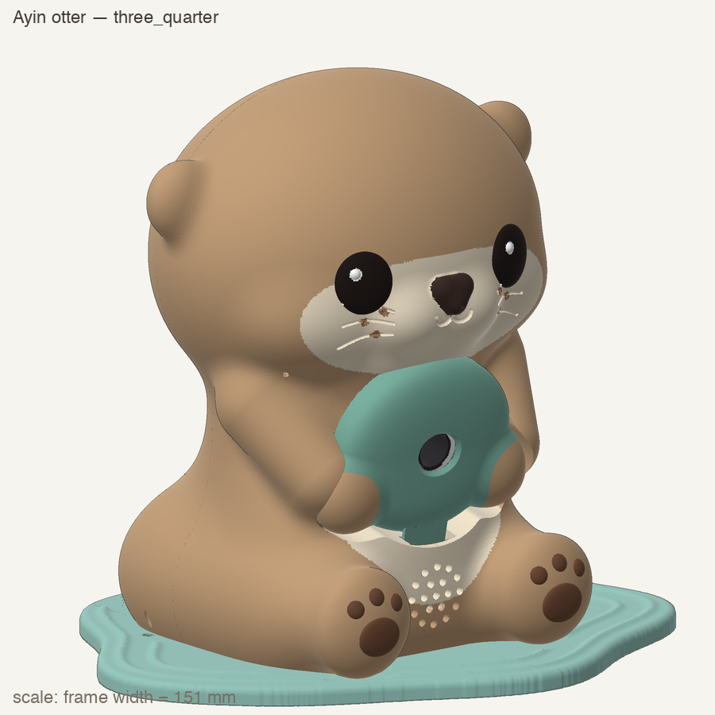
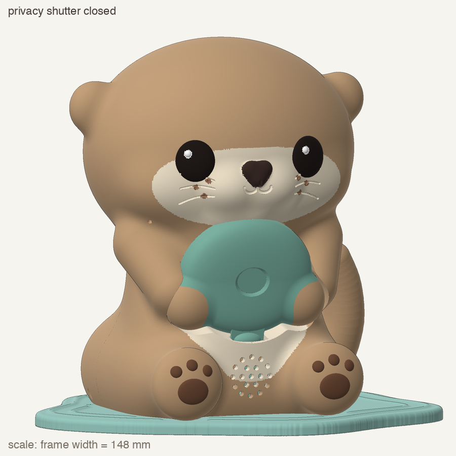
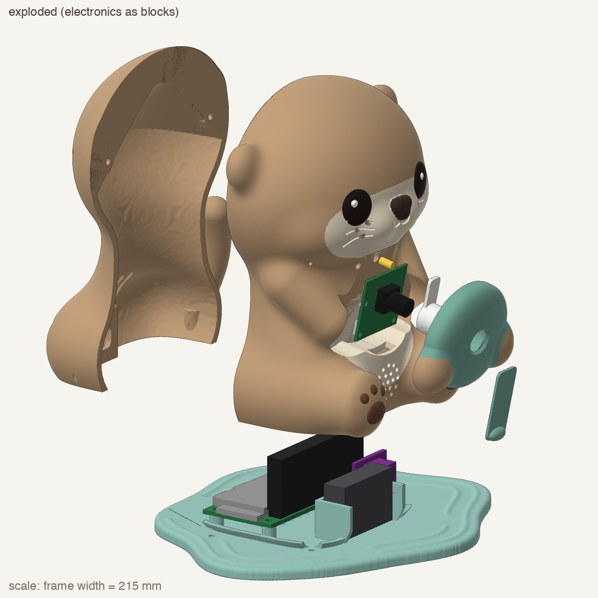

# Otter enclosure

A 3D-printable otter that sits at a work station. It hugs a teal pebble, and the camera lives in the pebble, not the eyes, so it never stares at the student's face. A shutter hidden in the pebble slides over the lens, so a student can see and feel that it can't see.



| Shutter closed | Parts |
| --- | --- |
|  |  |

**Why it looks like this.** AZACS staff told us anything worn on the body is a sensory problem, so Ayin is a desk buddy, not glasses. The shape follows Havi's otter character. The shutter and the light ring answer the privacy concerns about cameras around students.

## Build the print files

`otter/otter.py` builds every part from parameters (all sizes are at the top of the file), checks each one is a watertight solid, and writes STL files and renders.

```bash
cd hardware/otter
python3 -m venv .venv
.venv/bin/pip install manifold3d trimesh numpy scipy scikit-image pillow
.venv/bin/python otter.py                  # Raspberry Pi layout -> stl/ and renders/
.venv/bin/python otter.py --variant xiao   # XIAO ESP32-S3 layout -> stl/variant_xiao/
```

STL files aren't committed because they're large and rebuilt from the script.

**Print:** PLA, no supports, 5 mm brim on the two body shells, about 140 g of tan filament. The cream face and belly and the paw pads are painted on with acrylic afterwards.

## Status

- The current layout fits a Raspberry Pi Zero 2 WH (or the XIAO variant). The Raspberry Pi 4 we chose is larger, so the next version moves the Pi into a base that the otter sits on, with three button holes on the front for Done, Help and Show me.
- The parts have been checked on screen, not printed yet. The shutter may need light sanding.
